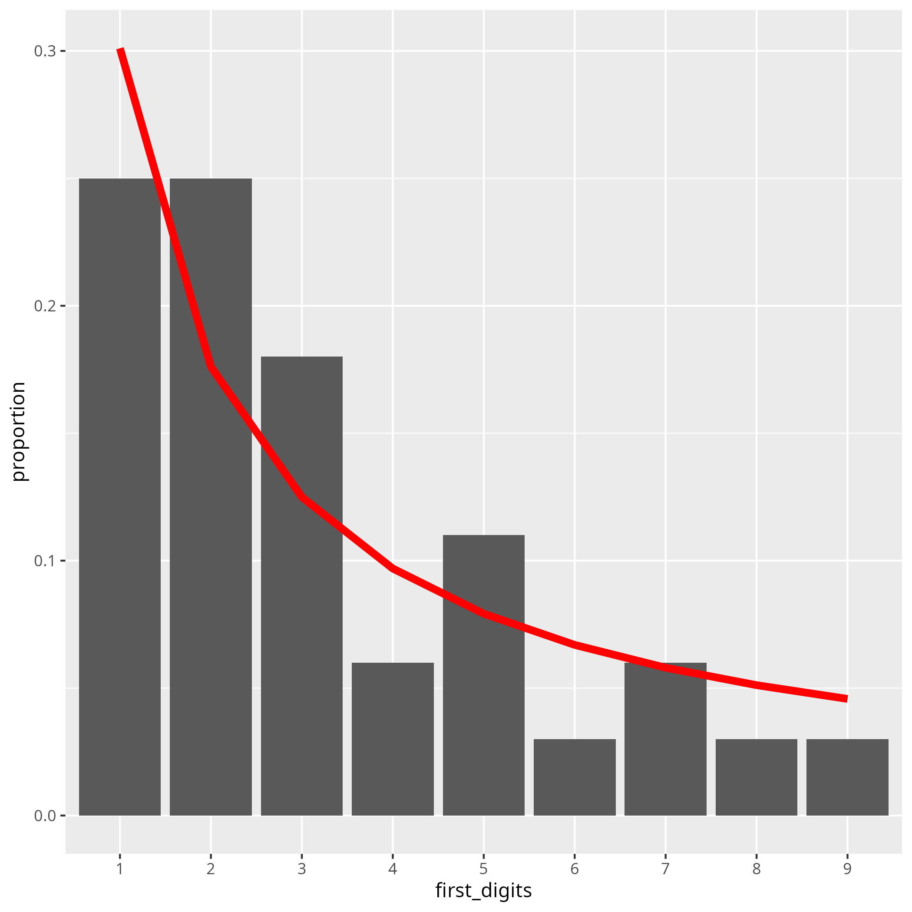
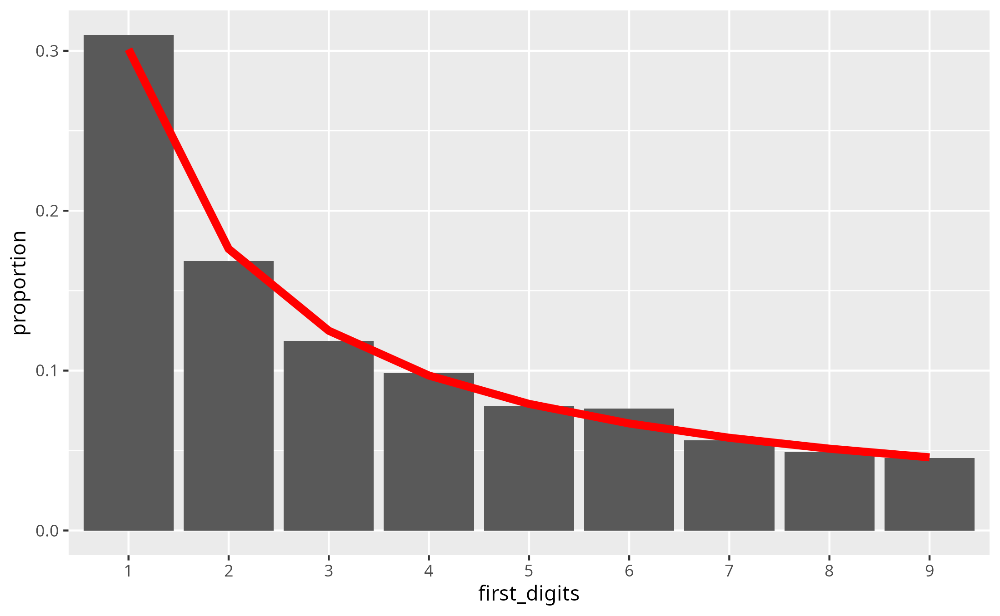

Benford's law* is a statistical regularity that stems from the observations that, in **real numerical datasets** with **large numbers**,
the leading digits tend to be small (e.g. large numbers are more likely to begin with 1's and 2,s ... than 8's and 9's). 

The mathematical formulation is the following (where $P(d)$ is the probability that a large number in a real dataset begins with the digit '*d*'):

$$
P(d) = \text{log}_{10} \left( 1+\frac{1}{d} \right)
$$

which gives the probabilities listed in the table below.

| digit | probability |
|-------|-------------|
|1 | 0.30103000 
|2 | 0.17609126 
|3 | 0.12493874 
|4 | 0.09691001 
|5 | 0.07918125 
|6 | 0.06694679 
|7 | 0.05799195 
|8 | 0.05115252 
|9 | 0.04575749
|--|------------------|

We stress that <u>Benford's law applies to</u>:

1. real numerical datasets
2. large numbers (e.g. $ \approx > 1e+5$)
3. large ranges (numbers spanning multiple orders of magnitude)

### 100 plant and animal genome sizes

To illustrate Benford's law, we assembled 100 genome sizes (in basepairs - bps) from the [Animal Genome Size Database](https://www.genomesize.com/)
and from the [Plant DNA C-values Database](https://cvalues.science.kew.org/); below, a few lines from this illustration dataset:

| species | kingdom | genome\_size (bps) |
|---------|---------|--------------------|
| *Homo sapiens* | animal | 3.2e+9 |
| *Bos taurus*     | animal | 2.7e+9 |
| *Triticum aestivum* | plant | 1.6e+10 |
| $$\ldots$$ | $$\ldots$$ | $$\ldots$$ |

This is a smallish dataset of just 100 records, with numbers ranging from 1e+8 to 1.5e+10 (2.5 orders of magnitude). 
In the plot below, we see the observed proportions of first digits (gray bars) and the theoretical expectations from Benford's law (red curve):

### Microbiome data

For a second example, we used rumen microbiome data from [Biscarini et al. 2018](https://journals.plos.org/plosone/article?id=10.1371/journal.pone.0205670);
in particular, we looked at the total number of counts per OTU ([operational taxonomic unit](https://en.wikipedia.org/wiki/Operational_taxonomic_unit): sort of 'microbial species').

| OTU | count |
|-----|-------|
| otu1 | 28779 |
| otu2 | 1241  |
| otu3 | 27008 |
| otu4 | 3045  |
| $$\ldots$$ | $$\ldots$$ |

We calculated the proportions of first digits in the data. 
This is a relatively larger dataset (2553 records), with numbers in the range 1e+0.3 - 1.7e+4 (3.5 orders of magnitude).
From the plot below, we see that in this real dataset, the observed proportions of first digits follow Benford's law much more closely:  

---

*Benford's law was discovered independently by Simon Newcomb (in 1881) and Frank Benford (the law's namesake, in 1938), who both noticed that the pages of books of logarithms that contained numbers beginning with 1 or 2 were more worn out than those with numbers beginning with 8 or 9. This reflected their use in real data problems by scientists and technicians. 
The law was formally proved only in 1995 by Ted Hill.

#### References

Biscarini, F., Palazzo, F., Castellani, F., Masetti, G., Grotta, L., Cichelli, A. and Martino, G., 2018. Rumen microbiome in dairy calves fed copper and grape-pomace dietary supplementations: Composition and predicted functional profile. PloS one, 13(11), p.e0205670.

